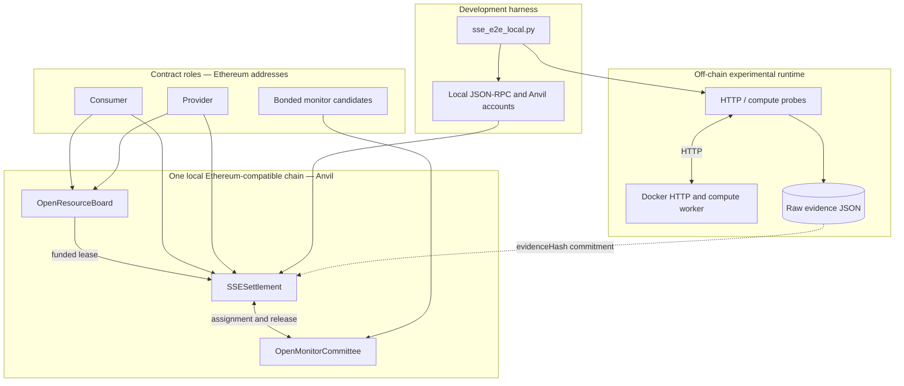
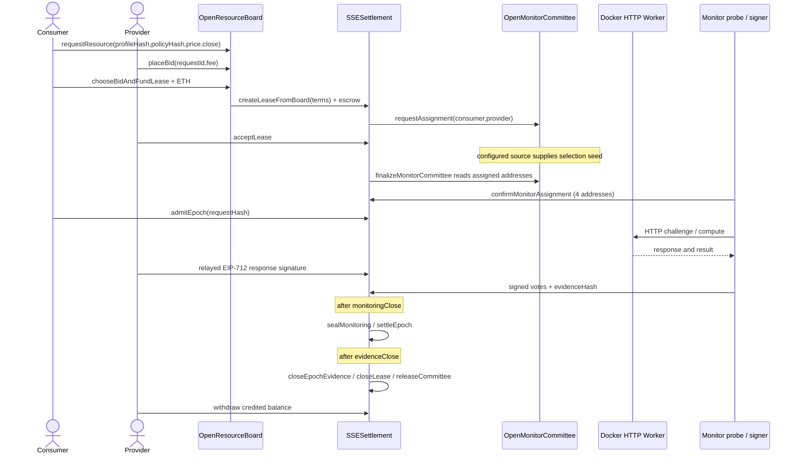

# SSE Milestone III — System Design and Implementation (report-ready source)

**Status:** descriptive material for the *existing* prototype. This file is not the final six-page article. Incorporate it into the revised Milestone II introduction and literature review without claiming that proposed infrastructure is deployed.

## 1. Scope and design goals

This artifact implements a restricted **Settlement-Sufficient Evidence (SSE)** instance for Ethereum-based intercloud service leasing. The research mechanism is financial: when authenticated evidence remains consistent with more than one contractual history, the contract allocates only amounts guaranteed across every admitted history and retains the rest. The provider HTTP/Docker service is an experimental source of observations; it is not itself the contribution.

Goals: **G1** contractual escrow without a trusted marketplace operator; **G2** signed and lease/epoch-bound report attribution; **G3** conservative monotonic partial settlement under ambiguous evidence; **G4** bounded additional exposure when admitting epochs; **G5** reproducible local proof-of-concept with honest disclosure of assumptions.

The prototype does not establish independent physical monitoring, oracle truth, cryptographic network delivery time, general arbitrary SLA inference, organizational Sybil resistance, or production multi-cloud provisioning.

## 2. Participants, registration and permissions

- **Consumer:** any Ethereum address may publish a resource request or create a directly funded lease. Only the named consumer can select their bid, admit epochs and close their lease.
- **Provider:** any eligible account may bid on someone else's marketplace request. Only the selected/named provider may accept that lease or authorize a provider ACK/response via EIP-712.
- **Monitoring candidate:** any address can attempt bond-backed registration, subject to the current 32-identity cap, minimum bond, and lifecycle restrictions. No organizational whitelist or identity verification is used. The pool is open-entry, but not fully Sybil-resistant or unbounded.
- **Selected monitor:** the existing prototype selects exactly four candidate *addresses* using a seed supplied by an authorized randomness operator. All four must confirm for lease readiness. Only confirmed selected addresses may vote; three matching votes classify the outcome. **The fixed 3-of-4 rule is a prototype choice, not an SSE theorem or network consensus threshold.**
- **Randomness operator:** a configured trusted address supplies the seed. The contract freezes the candidate snapshot before the seed but does not prove the seed unbiased.
- **Relayer/executor:** any address can submit authenticated EIP-712 votes on behalf of authorized signers; any address may also perform deterministic lifecycle calls after their preconditions hold (committee finalization, sealing, settlement, evidence closure, release). The relayer is not entitled to choose payouts.
- **Deployment bootstrapper:** wires the board, committee and settlement contracts once. Does not retain a general payment administrator capability.

**Permissionless network versus application authorization:** The intended network can be public/permissionless Ethereum or an Ethereum-compatible public chain. The actual experimental chain is local Anvil (chain ID 31337), **not** a permissioned Besu QBFT validator deployment. Application-specific restrictions on who can sign a lease response or vote do not convert the underlying blockchain into a permissioned consensus network.

## 3. Ethereum nodes, consensus, PKI and setup

**Implemented environment:** Solidity 0.8.24 contracts compiled with Foundry; EVM executed on one Anvil local development instance; RPC exposed at `127.0.0.1:8545`. Anvil's local block production and `evm_increaseTime` are testing facilities, not evidence of a distributed Ethereum consensus experiment. Ethereum EOA addresses and ECDSA signatures provide key-based authentication. EIP-712 domains bind messages to `SSESettlement`, version 1, chain ID and verifying contract address. The system has no X.509 certificate authority or independent organizational PKI. Monitor registration is a bond-backed smart-contract procedure, not proof of legal identity.

**One-time setup:** deploy `OpenMonitorCommittee`, `SSESettlement`, `OpenResourceBoard`; bind committee and board to the intended settlement contract; register sufficient bonded monitor identities. The reciprocal resource-board binding protects the funded marketplace path. Verify contract addresses, chain ID and EIP-712 domain before interpreting results.

**Not implemented:** deployed permissionless validator participation, Besu QBFT, independent monitor nodes, automatic wallet/key-custody service, independent certificate enrollment. These must not be listed as experimental facts.

## 4. Component architecture



**Implemented vs. target:** all components above exist in the repository, but one local orchestrator controls the demonstration's participant accounts and probes. The complete future independent infrastructure is not shown as implemented.

## 5. Storage and trust boundaries

**On-chain contract state:** marketplace requests/bids; lease consumer/provider, escrow, profile/SLA/endpoint commitments and fee parameters; committee candidates/bonds/assignment/confirmations; epoch request and deterministic response hashes, deadlines, outcomes, vote flags/counts, evidenceHash commitments, credited balances and unresolved exposure.

**Blockchain history:** transactions and calldata, emitted events and receipts, block timestamps and cryptographic state commitments. Block/receipt history is not the same as raw HTTP observations.

**Off-chain:** Docker image and actual CPU workload, resource-profile JSON, complete HTTP request/response observations, local timestamps, detailed per-monitor evidence records, operational logs and signing secrets. Only the cryptographic hash of a monitor's canonical JSON is included in the typed vote and stored by the contract. Hash matching establishes byte integrity and, when checked on-chain, commitment inclusion; it does not certify accuracy, service honesty, timing or independent ownership.

## 6. System workflow



**Important qualification:** The complete sequence above is the *combined intended protocol*; the previously successful local Docker demonstration created a direct lease without exercising `OpenResourceBoard`. The provider's separate on-chain signed response was not a signed HTTP receipt, and the monitor probes were not independently hosted. Anvil simulated time was advanced for settlement.

## 7. SSE financial model and pseudocode

For fixed epoch fee `f`, reservation entitlement `r`, and admissible histories `N` (unverified receipt), `F` (received/failure), `S` (fulfilled), the restricted contract implements `F(N)=r`, `F(F)=0`, `F(S)=f`.

Let `H(E)` be the current nonempty admissible set, `L=min(F(h))` and `U=max(F(h))` across `h` in `H(E)`. Guaranteed provider credit is `L`, guaranteed consumer credit is `f-U`, and unresolved funds are `U-L`. Conservation: `L+(f-U)+(U-L)=f`.

```text
settleEpoch(lease, epoch):
    require epoch.monitoringSealed
    histories := {N,F,S}
    if authenticatedProviderACK: histories := histories intersect {F,S}
    if monitorOutcome == Success: histories := histories intersect {S}
    if monitorOutcome == Failure: histories := histories intersect {N,F}
    require histories nonempty
    L := min entitlement over histories
    U := max entitlement over histories
    require L >= previouslyCreditedProvider
    require f-U >= previouslyCreditedConsumer
    require U-L <= previouslyUnresolved
    increment provider and consumer credits by differences
    update retained exposure to U-L
```

```text
admitEpoch(lease, requestHash):
    require caller is consumer and lease is Ready/Active
    require unused hash, available epoch slot and enough escrow
    require currentExposure + epochFee <= exposureBudget
    compute expected responseHash = Keccak(ABI(Keccak("SSE_RESPONSE"),requestHash))
    set responseDeadline, monitoringClose, evidenceClose from block.timestamp
    reserve full epochFee as initial uncertain exposure
```

**Scope:** This is a fixed three-history demonstrator and a conservative per-epoch admission policy. It is not a general arbitrary-history solver or complete dispute-finality model. Monotonic payout safety is conditional on the true history remaining admissible and the monitors' evidence interpretation being sound.

## 8. Threat model and assumptions

- **Consumer may be dishonest:** consumer-signed request creation is not proof of delivery to provider; consumer cannot submit a provider ACK or vote as an unselected monitor.
- **Provider may be dishonest:** Ethereum signature authenticates provider identity but not actual timely HTTP delivery. The deterministic challenge response is publicly computable. Runtime correctness is not implied by a hash alone.
- **Monitors may lie or collude:** 3-of-4 majority counting is a prototype decision; selected addresses are not assured to be independent organizations. Sound narrowing to `S`/`F` assumes sufficient honest observations under a stated fault model.
- **Randomness source:** designated source may bias seeds. Snapshotting prevents certain candidate changes after request, not biased seed selection.
- **Network clocks and omissions:** unauthenticated local timestamps and delayed/missing packets may cause observations that cannot certify contractual timeliness. On-chain deadlines govern when submissions are accepted, not when a remote packet arrived.
- **Blockchain:** assumes EVM transaction correctness and irreversibility of appropriately finalized state. Actual tests run on single-node Anvil and do not establish distributed consensus resilience.
- **Admissibility soundness:** if the true history is incorrectly excluded, min/max bounds may be safe for the wrong set but unsafe in reality. Disputed amounts may remain retained if no further distinguishing evidence arrives.

## 9. Current verification and experimental limitations

The uploaded project previously demonstrated 79 Python tests and 17 Foundry tests passing locally; the current modification adds twelve Python tests (nine evidence-audit and three packaging) and seven Solidity research-protocol regression tests. The new Python suite passed in isolated review, with a temporary verified Keccak test shim because the sandbox does not provide the pinned `pycryptodome`. Foundry compilation and new Solidity tests must be run in the user's installed Foundry environment before claims about them are finalized.

A prior local Docker run reached lease 3 SUCCESS_COMPLETE, with 3 success votes, provider credit 25 wei and zero unresolved exposure. This is one local execution, not evidence of full-scale infrastructure or independent monitoring. The new `tools/m3_evidence_audit.py` validates saved Keccak commitments offline; with `--rpc-url`, it also compares monitor commitments to on-chain storage at one block. Neither proves observations are true.

## 10. Future work intentionally outside Milestone III minimum

Remote cloud provider and independently operated monitoring organizations, genuine permissionless-node deployment, automated `LeaseCreated` provisioning, signed HTTP receipts and credible timing proofs, fully parameterized monitor policy, Sybil defenses, a general admissible-history engine, and a final resolution rule for permanently disputed funds. Do not present these as implemented in this milestone.

## 11. AI disclosure requirement

The final article must include an **AI Usage Disclaimer immediately before References** and must highlight text that was actually AI-generated as required by the instructor. Any AI-created diagrams must be disclosed. The author must verify technical accuracy, references and final disclosures before submitting. This technical source document was drafted with AI assistance; do not submit it without accurate highlighting and editorial review.
